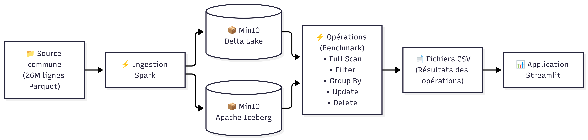
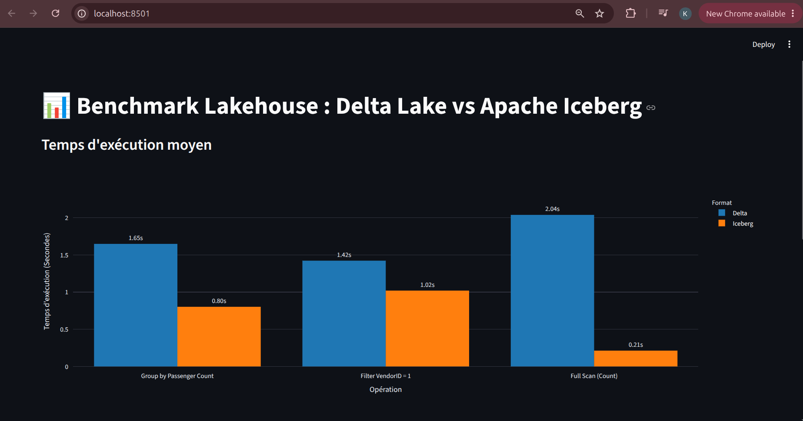
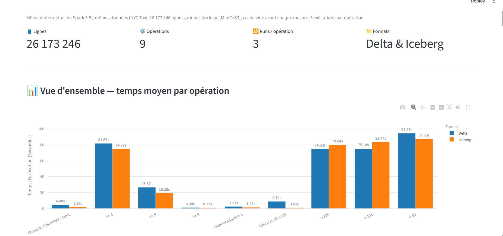

# delta-iceberg-performance-lab



## 1. Contexte du Projet
Les architectures de données modernes ont évolué des Data Lakes traditionnels vers le paradigme du Lakehouse. Un système Big Data moderne ne se contente plus de stocker des fichiers passifs ; il doit concilier la scalabilité du stockage objet et la rigueur d'un SGBD :
- Ingestion massive continue et par lots.
- Lectures analytiques complexes et performantes.
- Mises à jour et suppressions granulaires ACID (ex: conformité RGPD, CDC).
- Évolution dynamique des schémas de données (*Schema Evolution*).
- Élimination des surcoûts liés au listing de répertoires (*Small Files problem*).

Historiquement limités à des formats bruts (Parquet, ORC), les Data Lakes reposent désormais sur les **Table Formats** modernes — **Delta Lake** et **Apache Iceberg** — qui ajoutent une couche de métadonnées transactionnelles au-dessus des fichiers physiques.

---

## 2. Définitions

### 🔹 Delta Lake
Format de table Lakehouse open-source initié par Databricks. Il organise les données en fichiers Parquet et enregistre chaque transaction dans un journal d'audit ordonné (`_delta_log`). Ses atouts majeurs sont la conformité ACID complète, le *Time Travel*, la gestion stricte des schémas et son intégration native et poussée avec Apache Spark.

### 🔹 Apache Iceberg
Format de table ouvert pour les très grands volumes de données analytiques, conçu à l'origine par Netflix. Iceberg s'affranchit de la structure en dossiers en gérant les tables directement au niveau fichier grâce à une hiérarchie de métadonnées (*Metadata file*, *Manifest Lists*, *Manifests*). Ses atouts majeurs sont la suppression des listings lents sur stockage objet, le *data skipping* avancé, l'évolution de partitionnement sans réécriture et son indépendance vis-à-vis des moteurs de calcul.

---

## 3. Problématique
> **Question de recherche expérimentale :**  
> « Pour un même volume de données, avec le même moteur de calcul (Spark 3.5), les mêmes ressources matérielles et les mêmes opérations, quelles différences de performance, de comportement et d'empreinte de stockage observe-t-on entre Delta Lake et Apache Iceberg ? »

Le but n'est pas de déclarer un vainqueur universel, mais d'identifier empiriquement dans quelles conditions (lectures analytiques, filtrage, agrégations, écritures et modifications ACID) un format se montre plus avantageux que l'autre.

---

## 4. Objectifs du Projet
- **Ingestion & Écriture** : Charger **26,17 millions de lignes** (NYC Taxi) sur stockage objet MinIO au format Delta Lake et Apache Iceberg.
- **Benchmark Rigoureux** : Exécuter 5 scénarios clés en **3 runs successifs** pour isoler l'effet *Cold Start* (Run 1) du *Warm Cache* (Runs 2 et 3).
- **Analyse du Stockage** : Mesurer et séparer l'empreinte des données utiles de celle des fichiers de métadonnées.
- **Visualisation Interactive** : Fournir une application web Streamlit permettant d'analyser dynamiquement tous les graphiques et métriques.

---

## 5. Architecture du Projet

```
delta-iceberg-performance-lab/
├── app.py                     # Application Streamlit (tableau de bord interactif)
├── Dockerfile.app             # Image Docker pour le dashboard Streamlit
├── requirements-app.txt       # Dépendances Python Streamlit
├── infrastructure/            # Configuration de l'infrastructure conteneurisée
│   ├── docker-compose.yml     # Orchestration des 4 services (MinIO, Spark Master, Spark Worker, Streamlit)
│   ├── Dockerfile             # Image Spark 3.5 + Delta Lake + Iceberg + JARs S3
│   └── requirements.txt       # Dépendances Python Spark (boto3, pandas)
├── spark_jobs/                # Scripts de calcul Spark
│   ├── ingestion.py           # Ingestion 26,17M lignes vers Delta & Iceberg
│   ├── benchmark.py           # Benchmark : READ / FILTER / AGG / UPDATE / DELETE (3 runs)
│   └── storage_analysis.py    # Mesure des volumes Données vs Métadonnées
├── data/
│   ├── source/*.parquet       # Données sources NYC Taxi
│   ├── benchmark_results.csv  # Résultats générés du benchmark
│   ├── storage_metrics.csv    # Résultats générés de l'analyse stockage
│   └── minio/                 # Volume persistant du stockage objet MinIO
└── imgs/                      # Captures d'écran et graphiques de performance
```

---

## 6. Comment Lancer le Projet (Guide Pas-à-Pas)

Pour reproduire l'expérimentation de bout en bout, suivez ce workflow ordonné en 6 étapes :

```
[1. Lancer Docker] ➔ [2. Créer Bucket MinIO] ➔ [3. Ingestion] ➔ [4. Benchmark] ➔ [5. Analyse Stockage] ➔ [6. Accéder à l'App]
```

### 1️⃣ Étape 1 : Lancer l'Infrastructure Docker

Placez-vous dans le dossier `infrastructure/` et lancez tous les services en arrière-plan :

```bash
cd infrastructure
sudo docker compose up --build -d
```

Vérifiez que les 4 services sont bien démarrés :
```bash
sudo docker compose ps
```

| Service | Port local | Rôle / Accès |
|---|---|---|
| **MinIO Console** | `9090` | [http://localhost:9090](http://localhost:9090) *(admin / password)* |
| **MinIO API S3** | `9000` | Endpoint de stockage S3 interne |
| **Spark Master UI** | `8082` | [http://localhost:8082](http://localhost:8082) |
| **Spark Worker UI** | `8083` | [http://localhost:8083](http://localhost:8083) |
| **Streamlit App** | `8502` | [http://localhost:8502](http://localhost:8502) |

---

### 2️⃣ Étape 2 : Créer le Bucket MinIO (`deltavsicberg`)

Le stockage objet S3 nécessite le bucket **`deltavsicberg`** pour héberger les tables Delta Lake et Apache Iceberg.

#### Option A : Via l'interface web MinIO (Recommandé)
1. Ouvrez votre navigateur sur **[http://localhost:9090](http://localhost:9090)**.
2. Connectez-vous avec :
   - **Username** : `admin`
   - **Password** : `password`
3. Dans le menu de gauche, cliquez sur **Buckets**, puis sur le bouton **Create Bucket**.
4. Nommez le bucket **`deltavsicberg`** et cliquez sur **Create Bucket**.

#### Option B : En ligne de commande (Automatisé)
Vous pouvez également créer le bucket avec cette commande directe :
```bash
sudo docker exec -it spark-master-lab /opt/bitnami/spark/venv/bin/python3 -c "
import boto3
s3 = boto3.client('s3', endpoint_url='http://minio:9000', aws_access_key_id='admin', aws_secret_access_key='password')
existing = [b['Name'] for b in s3.list_buckets().get('Buckets', [])]
if 'deltavsicberg' not in existing:
    s3.create_bucket(Bucket='deltavsicberg')
    print('✅ Bucket deltavsicberg créé avec succès.')
else:
    print('ℹ️ Bucket deltavsicberg déjà existant.')
"
```

---

### 3️⃣ Étape 3 : Lancer l'Ingestion des Données

Cette étape lit les données brutes NYC Taxi (~26,17 millions de lignes Parquet dans `data/source/`) et écrit les tables dans MinIO :
- **Delta Lake** : `s3a://deltavsicberg/delta/yellow_tripdata`
- **Apache Iceberg** : table `iceberg_catalog.default.yellow_tripdata`

Lancez l'ingestion via Spark :

```bash
sudo docker exec -it \
    -e PYSPARK_PYTHON=/opt/bitnami/spark/venv/bin/python3 \
    -e PYSPARK_DRIVER_PYTHON=/opt/bitnami/spark/venv/bin/python3 \
    spark-master-lab \
    spark-submit /opt/bitnami/spark/jobs/ingestion.py
```

> ⏳ *À la fin de l'ingestion, le script confirme le succès de l'écriture pour les deux formats.*

---

### 4️⃣ Étape 4 : Lancer le Benchmark de Performances

Le benchmark exécute **5 opérations distinctes** avec **3 runs par opération** (avec vidage de cache Spark avant chaque run) :
1. **Full Scan (Count)** : lecture intégrale des 26,17 M lignes.
2. **Filtrage (Data Skipping)** : sélection ciblée sur `VendorID = 1`.
3. **Agrégation** : `GROUP BY passenger_count` et `SUM(total_amount)`.
4. **UPDATE ACID** : modification de `payment_type` sur ~20,9 M lignes.
5. **DELETE ACID** : suppression de lignes spécifiques.

Lancez le benchmark :

```bash
sudo docker exec -it \
    -e PYSPARK_PYTHON=/opt/bitnami/spark/venv/bin/python3 \
    -e PYSPARK_DRIVER_PYTHON=/opt/bitnami/spark/venv/bin/python3 \
    spark-master-lab \
    spark-submit /opt/bitnami/spark/jobs/benchmark.py
```

Les temps d'exécution sont enregistrés dans **`data/benchmark_results.csv`**.

---

### 5️⃣ Étape 5 : Lancer l'Analyse du Stockage (Storage)

Ce script analyse le volume physique des données sur MinIO en séparant les fichiers de données brutes des fichiers de métadonnées.

Lancez l'analyse de stockage :

```bash
sudo docker exec -it spark-master-lab \
    /opt/bitnami/spark/venv/bin/python3 /opt/bitnami/spark/jobs/storage_analysis.py
```

Les métriques sont enregistrées dans **`data/storage_metrics.csv`**.

---

### 6️⃣ Étape 6 : Accéder à l'Application Dashboard (Streamlit)

Une fois les calculs achevés, visualisez l'ensemble des graphiques et analyses sur l'interface Streamlit.

#### Accès via Docker (par défaut) :
Le conteneur `streamlit-app` est déjà actif :

👉 **Ouvrez : [http://localhost:8502](http://localhost:8502)**

#### Alternative : Lancement en local (sur l'hôte) :
```bash
pip install -r requirements-app.txt
streamlit run app.py
```
👉 **Ouvrez : [http://localhost:8501](http://localhost:8501)**

---

### 🛑 Arrêt & Nettoyage

Pour arrêter les conteneurs :

```bash
sudo docker compose down
```

---

## 7. Interprétation des Résultats

Benchmark exécuté sur le jeu de données **NYC Taxi (26 173 246 lignes)**, sur **Spark 3.5**, avec stockage objet **MinIO (S3)**, cache vidé avant chaque mesure, et **3 runs par opération**.

### 1. Temps d'exécution moyen par Opération


| Opération | Delta Lake (moy.) | Apache Iceberg (moy.) | Facteur / Gain Iceberg |
|---|---|---|---|
| **Full Scan (Count)** | 8.74 s | 0.46 s | **Iceberg 19.0× plus rapide** |
| **Filter VendorID = 1** | 2.33 s | 1.26 s | **Iceberg 1.8× plus rapide** |
| **Group by Passenger Count** | 4.48 s | 1.58 s | **Iceberg 2.8× plus rapide** |

**Constat :** Apache Iceberg domine très nettement les trois charges de lecture analytique sur stockage objet.

---

### 2. Analyse Cold Start vs Warm Cache


Le découpage par run permet de comprendre le comportement initial ("à froid") et stabilisé ("avec cache") :

1. **Full Scan (Count)** :
   - *Cold Start (Run 1)* : Delta prend **23.90 s** contre **1.04 s** pour Iceberg. L'architecture d'Iceberg repose sur des manifests listant explicitement les fichiers Parquet : elle élimine le coût du listing récursif de répertoires sur S3 que Delta subit au premier appel.
   - *Warm (Runs 2 & 3)* : les temps chutent (Delta ~1.2 s, Iceberg ~0.17 s), mais Iceberg reste structurellement plus véloce pour résoudre ses métadonnées.

2. **Filtre (VendorID = 1)** :
   - Iceberg l'emporte sur l'ensemble des runs (Run 1 : **2.94 s** vs **4.47 s**). Ses statistiques min/max intégrées au niveau fichier permettent un élagage (*data skipping*) très efficace.

3. **Agrégation (Group by Passenger Count)** :
   - Iceberg est systématiquement devant (Run 1 : **2.79 s** vs **10.07 s**), grâce à un scan ciblé des seules colonnes nécessaires avant la phase de *shuffle*.

---

### 3. Écritures ACID (UPDATE & DELETE)
Sur les 26,17 millions de lignes réelles modifiées à chaque itération :

- **UPDATE** (*modifier payment_type sur ~20,9 millions de lignes*) :
  - Performances très proches (réécriture de fichiers Parquet + commit de métadonnées) : Iceberg prend 87.63 s vs 94.47 s pour Delta sur le Run 1, et Delta est légèrement plus rapide sur les Runs 2 et 3.
- **DELETE** (*suppression de lignes ciblées*) :
  - Iceberg est plus rapide sur les 3 runs (ex: Run 1 : **74.97 s** vs **81.63 s**).

---

### 4. Synthèse Globale

- **Lectures analytiques & requêtes interactives** : **Apache Iceberg** offre un avantage déterminant grâce à sa structure de métadonnées qui évite les opérations de listing coûteuses sur le stockage objet et maximise le *pruning*.
- **Mises à jour massives (UPDATE)** : **Delta Lake** reste très compétitif sur les modifications lourdes de données existantes.
- **Lakehouse Moderne** : Le choix entre les deux technologies dépend de la dominance de votre charge (lectures intensives BI/Analytics vs écritures fréquentes et intégration Databricks).
